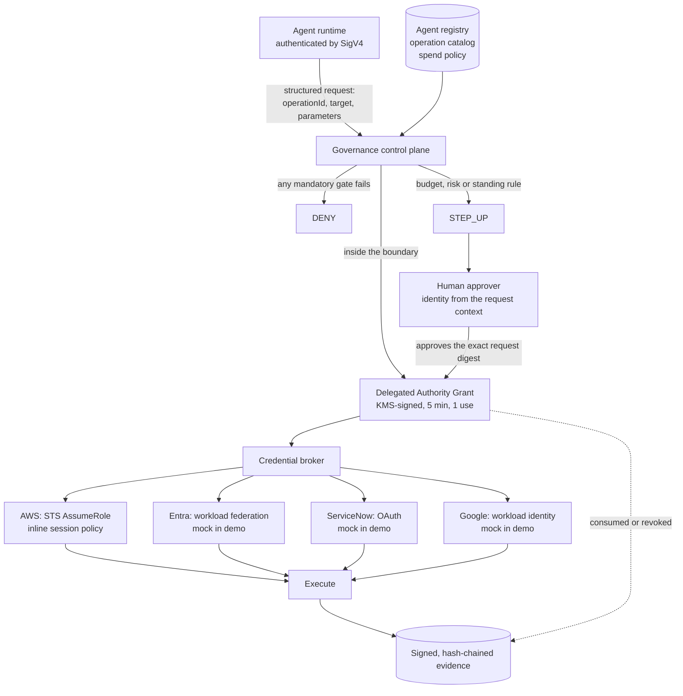

# Delegated Authority ("hall pass") architecture

**The governance model is vendor-neutral. Provider IAM/OAuth systems are enforcement mechanisms.**

An AI agent operates autonomously only inside a short-lived, explicit, cryptographically verifiable authority envelope. Leaving that envelope results in denial or human escalation, regardless of which model, cloud or API executes the action.

Humans do not approve every low-risk action. Humans approve the boundaries an agent operates within: its registry entry, the operation catalog, its spend policy and the policy bundle. The control plane evaluates every request against those boundaries and issues authority only inside them.

## Flow

The chain for every action is recorded and linked:

Agent -> Request -> Decision -> Approval (if any) -> Grant -> Credential reference -> Execution -> Evidence.

## Components

| Concern | Module | Notes |
|---|---|---|
| Agent identity | `authority_identity.py` | Identity comes from the API Gateway request context (IAM/SigV4 or JWT). A principal registered as an agent runtime is always an agent, whatever roles are recorded for it. |
| Registry | `models.AgentRegistryEntry`, `agent_registry.py` | Agent type (worker, guardian, governance), owners, approved providers, operations, resource patterns, data classes, spend policy, grant TTL, guardians, risk tier, status. Older entries load with safe defaults. |
| Operation catalog | `operation_registry.py`, `operation_catalog/public_sector_demo.openapi.json` | Every executable operation has a stable `operationId` and an `x-governance` block. The operationId is the authorization subject. An unregistered operation is denied. |
| Policy evaluation | `authority_control_plane.py`, `operation_catalog/delegated_authority_policy.json` | Ordered gates produce facts; the embedded OPA engine resolves the verdict. A failed gate can never be overridden by policy or by a human approval. |
| Autonomy scope | Scope Table | The current scope lives only in the Scope Table (the kill switch writes there). The effective scope is the lower of current and approved scope. |
| Human escalation | `approval_workflow.py`, `api_router.py` | One approval record per escalated decision, bound to the request digest and an absolute expiry, consumed exactly once. |
| Delegated Authority Grant | `delegated_authority.py` | KMS-signed, DynamoDB-persisted, conditionally consumed and revoked. |
| Credential exchange | `credential_broker/` | Accepts only a grant that this control plane verified and consumed. Returns metadata; the credential never leaves the handle. |
| Evidence | `authority_evidence.py` | Hash-chained, ECDSA-signed records in S3. A guard refuses to write anything that looks like a credential. |

## The grant is not a credential

A Delegated Authority Grant is proof that governance authorized one specific action. It contains the agent, session, provider, operationId, exact target, exact parameters, data class, spend limit, scope, environment, decision id, approval id, policy version hash, request digest, issue and expiry times, and use count, signed with a dedicated KMS key (ECC_NIST_P256, ECDSA_SHA_256).

It never contains a token, key or password. The credential broker exchanges a verified grant for a provider-native credential that is no broader than the grant:

* AWS: `sts:AssumeRole` on a dedicated execution role with an inline session policy that allows only the operation's IAM actions on the one ARN the grant names, with `aws:CurrentTime` before the grant's expiry. STS credentials last at least 900 seconds; the condition makes them useless once the 5-minute grant expires. Session tags and SourceIdentity carry `grant_id`, `agent_id` and `decision_id` into CloudTrail.
* Entra, ServiceNow, Google: the same interface. The demo runs these as mock adapters. Live mode is the integration point for the customer's workload identity federation or OAuth client credentials and refuses to run until those settings exist; nothing is hard-coded.

Each grant gets its own credential and its own session policy, so nothing is shared or mutated between agents. The repository's permission-boundary swap on a shared role remains a separate research experiment (see the compromised-enforcer experiment) and is not used on this path.

## Why authority binds to the exact request

The canonical request contains only security-relevant fields: agent, session, provider, operationId, target, parameters, environment, data class, and the financial subject (currency and amount). Free text (prompt, stated intent, business reason) is kept as context and never decides the privilege.

The request digest is SHA-256 over the canonical request, the policy version hash, and (for approvals) the absolute expiry. Canonical JSON sorts keys, normalizes numbers (4, 4.0 and Decimal("4.00") are equal; the string "4" is not), and rejects NaN, infinity and parameter names that look like credentials.

* **TOCTOU protection.** A human approves a digest. If anything changes between approval and execution (amount, quantity, target, operation, agent, session, environment, or the policy itself), the digest no longer matches and the request is denied. The failed attempt does not consume the approval.
* **Replay protection.** Approvals and grants are consumed with DynamoDB conditional writes. Of any number of concurrent attempts, one succeeds. A consumed, revoked or expired grant is denied.
* **Policy drift protection.** The policy version hash covers the operation catalog, the policy bundle, the agent's policy-relevant registry fields, the approved catalog and the escalation threshold. An approval granted under one policy cannot be redeemed under another.

## Spending authority is not security authority

Budget limits let a worker buy an approved catalog item on its own. They never confer privileges.

* The amount is derived server-side (catalog unit price x quantity). An understated claim is denied.
* Running totals come from the control plane's own spend ledger, never from the request. Autonomous spend is capped atomically at execution, so two grants that were each within budget cannot together exceed it.
* Above the autonomous limits the request steps up to a human; above the hard maximum it is denied outright.
* Granting a privilege is a separate operation. Adding a member to a privileged directory group is human-only, and a purchase that carries an extra privilege parameter is rejected by the operation's parameter schema.

## Agents watching agents

| Agent type | May | May not |
|---|---|---|
| worker | Perform approved business operations within scope and budget | Act on any other agent or governance resource; change its own authority |
| guardian | Inspect assigned workers' signed decisions and evidence, recommend suspension, raise alerts | Grant scope, change policy, approve exceptions, change monitoring, approve anything, act on itself, hold spending authority |
| governance | Governance bookkeeping operations | Any human-only action |

Human-only actions reuse `CedarEngine.HUMAN_ONLY_ACTIONS` (GrantScope, AmendPolicy, ApproveException, OverrideDecision, MakeComplianceDetermination, and others). A guardian's suspension recommendation records `effect_on_authority: none`; only a human changes scope or activates the kill switch.

## Consumption, revocation and the kill switch

* Consume: the only path to a credential, one use per grant by default.
* Revoke: operators and governance administrators revoke any ACTIVE grant immediately.
* Kill switch: sets the agent's scope to 0 and revokes all of its ACTIVE grants. Every later request fails at the kill-switch gate. Only a governance administrator restores scope, through the admin plane, never above the registry's approved scope.

## Fail-closed behaviour

No rule, unknown tool, unknown operation, unverified identity, invalid or foreign signature, expired, revoked or consumed grant, modified approved request, missing structured fields, authority-changing fields from an agent, unavailable spend ledger, unavailable grant store, or missing configuration: each one denies.

## AgentCore

AgentCore Gateway (OpenAPI targets, JWT/OAuth inbound authorization) and AgentCore Identity are possible implementation options for exposing these operations, subject to the customer's residency requirements and the current CCCS assessment at the time of use. The architecture does not depend on them.

As of this writing the AgentCore developer guide lists Canada (Central) (`ca-central-1`) as a source Region for global cross-Region inference for Policy in AgentCore, which means requests may be processed outside Canada. The demo therefore does not use AgentCore Policy; policy evaluation runs in the stack's own Lambda in the deployment Region. Re-check the AgentCore documentation before any customer deployment.

## Demo versus production

Safe to demonstrate: the full decision, approval, grant, broker, AWS STS, revocation, kill switch and evidence paths, all of which run in the offline demo and in the deployed stack.

Not production-ready yet:

* Entra, ServiceNow and Google adapters are mocks; live federation is an integration point.
* The approved software catalog is demo data in code; production would source it from the procurement system.
* Session and daily spend totals are kept in one DynamoDB table without reconciliation against the provider's records.
* The local UI is a presentation aid bound to 127.0.0.1, not a product UI.
* Evidence uses the standard evidence bucket; production should write to the Object Lock bucket.
